# Cum se joacă Another Dino

Un dinozaur care aleargă printr-o lume din voxeli (cuburi mici, ca pixelii, dar în 3D). Sari, te ghemuiești, strângi oase și ajungi cât mai departe. Jocul merge complet offline. Multiplayerul folosește rețeaua locală (Wi-Fi sau hotspot), fără internet.

## Unde se joacă

| Platformă | Cum |
| --- | --- |
| Android | Instalezi `Another-Dino-android.apk` din ultima versiune de pe GitHub (Releases). |
| Windows | `Another-Dino-win-x64.exe` (cu instalare, se actualizează singur) sau `Another-Dino-windows-portable.exe` (fără instalare). |
| macOS / Linux | `.dmg` / `.AppImage` din Releases. |
| Browser | Pagina jocului de pe GitHub Pages. Pe telefon o poți pune pe ecranul principal. |

Multiplayerul LAN merge doar în aplicații (Android și PC), pentru că browserul nu are acces la rețeaua locală.

## Pas cu pas, în imagini

Numerele din chenarele roșii corespund listei de sub fiecare imagine.

### Meniul principal

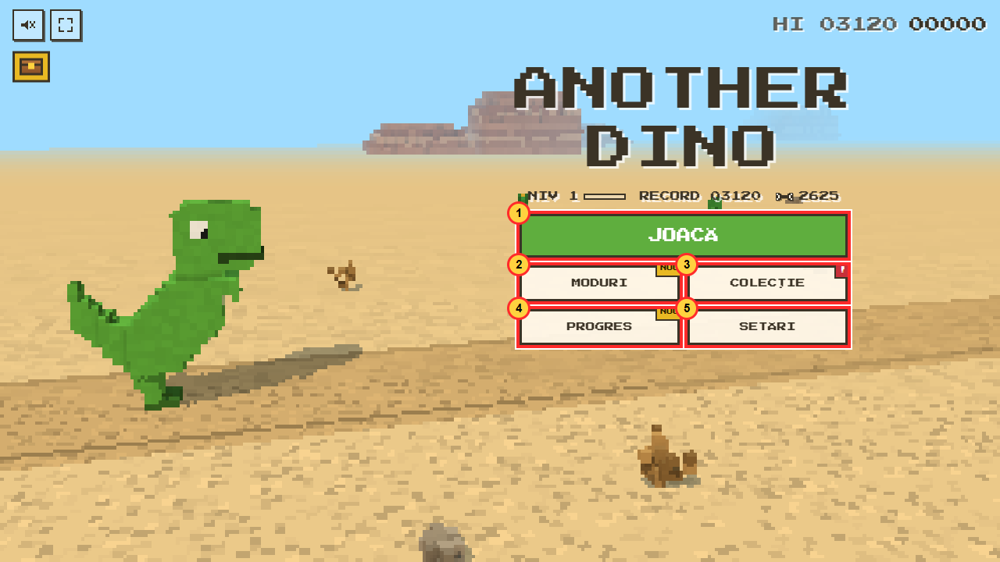

1. **JOACĂ:** pornește o tură normală.
2. **MODURI:** Aventura, Boss Rush, multiplayerul și celelalte moduri.
3. **COLECȚIE:** Magazinul, Albumul, Bestiarul, Pass-ul și Tonomatul.
4. **PROGRES:** misiunile, medaliile, statisticile și Cartea de jucător.
5. **SETĂRI:** limba, sunetul, controalele, grafica, accesibilitatea și transferul de progres.

Bulina roșie sau eticheta NOU arată că acolo te așteaptă ceva.

### În timpul jocului, pe PC

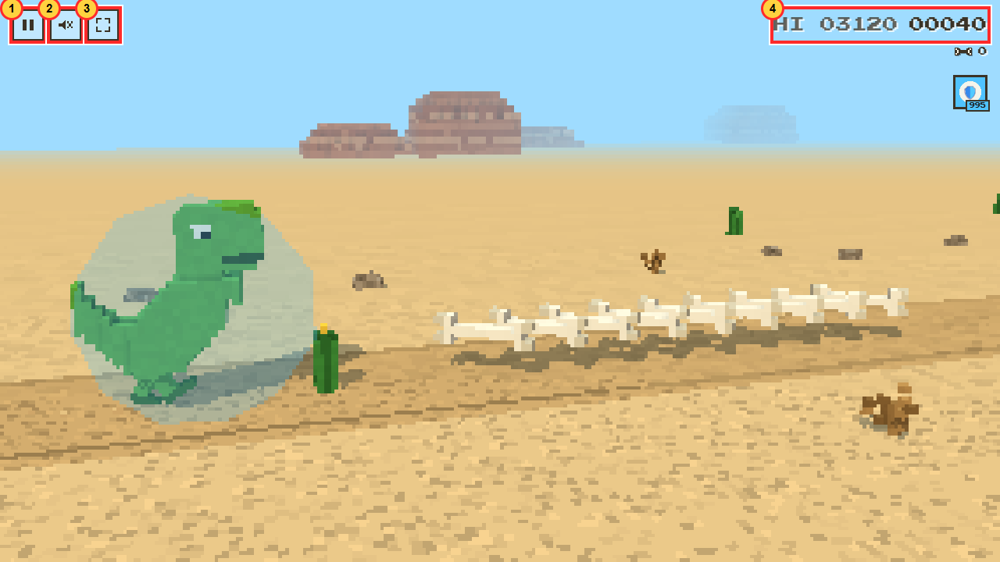

1. **Pauză** (sau tasta Esc / P).
2. **Sunet** pornit sau oprit.
3. **Ecran complet.**
4. **Recordul (HI) și scorul** turei de acum. Sub ele sunt oasele strânse.

Sari cu **Space** sau **↑** și te ghemuiești cu **↓**.

### Pe telefon

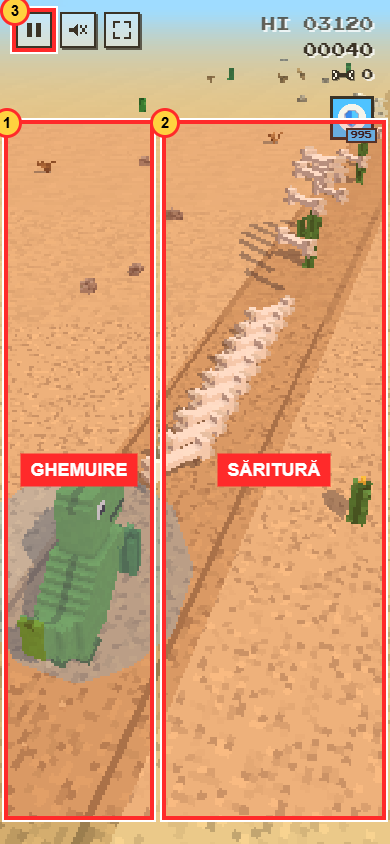

1. **Ghemuire:** ține degetul pe partea stângă a ecranului. Dacă apeși în aer, dino lovește pământul.
2. **Săritură:** atinge partea dreaptă. Dacă ții degetul, sare mai sus.
3. **Pauză.**

Granița dintre zone se poate muta, sau poți pune două butoane vizibile, din **Setări > Control > Comenzi pe ecran**.

### Pauza

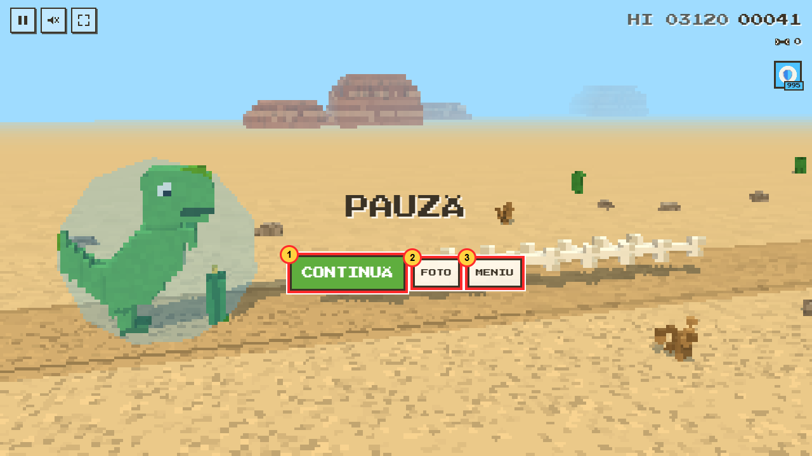

1. **CONTINUĂ** tura.
2. **FOTO:** modul foto, ca să faci o poză scenei (ajunge în Album).
3. **MENIU:** ieși din tură.

### Game Over

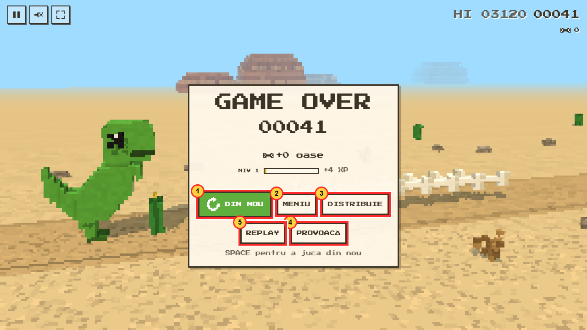

1. **DIN NOU:** o tură nouă (sau Space).
2. **MENIU.**
3. **DISTRIBUIE:** o imagine cu scorul tău, de trimis.
4. **PROVOACĂ:** un cod QR cu traseul tău. Prietenul îl scanează și încearcă să te bată pe același traseu.
5. **REPLAY:** ultimele 10 secunde, care se pot salva ca GIF.

### Modurile

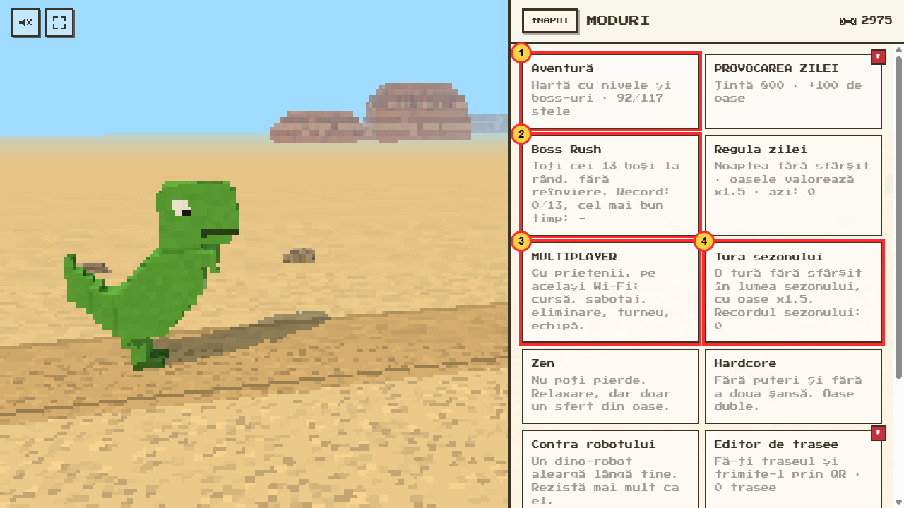

1. **Aventura:** harta cu lumi, niveluri și boși.
2. **Boss Rush:** toți boșii la rând.
3. **Multiplayer:** jocul în rețeaua locală (vezi mai jos).
4. **Tura sezonului:** tura fără sfârșit în lumea sezonului.

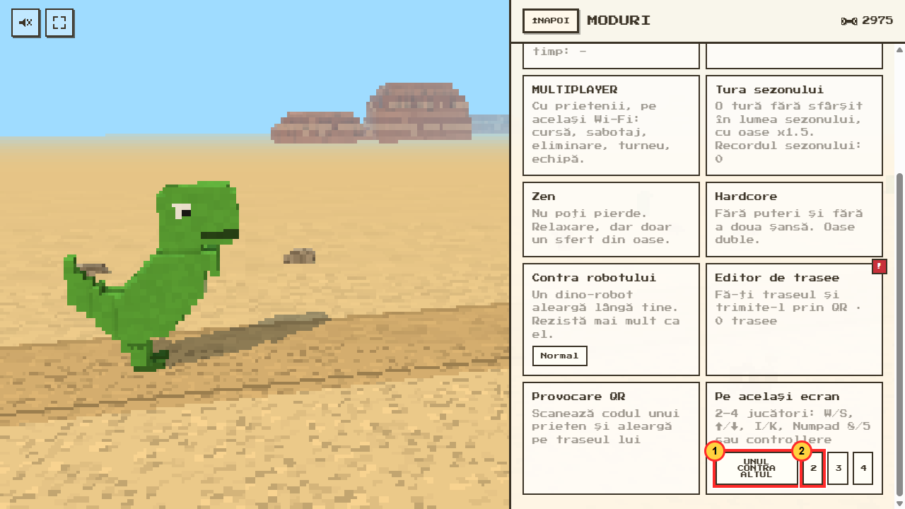

**Pe același ecran:**
1. Butonul comută între **UNUL CONTRA ALTUL** și **ÎN ECHIPĂ** (3 inimi comune și boss de echipă).
2. Apoi alegi câți jucători sunteți: **2**, **3** sau **4**.

### Aventura

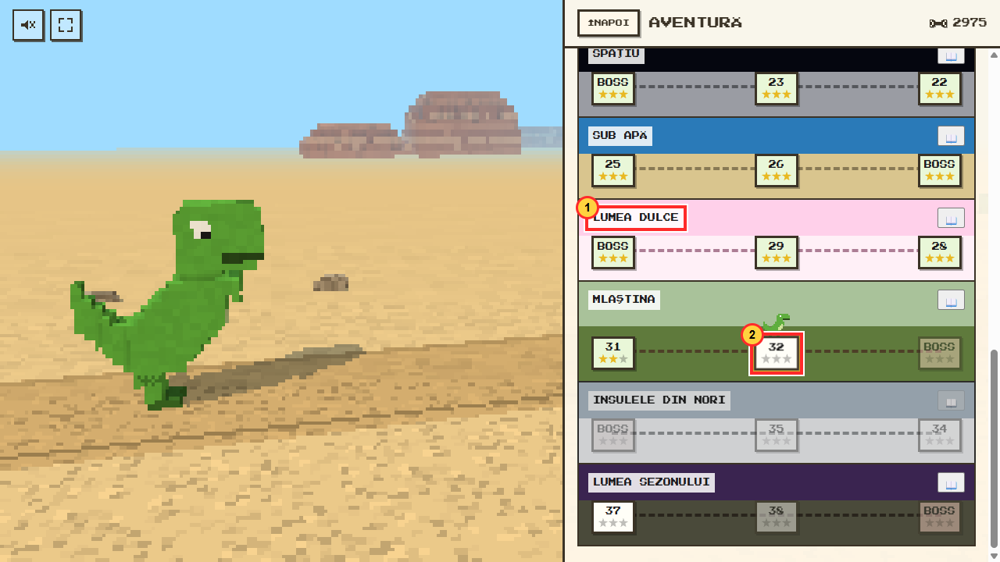

1. Fiecare bandă e o lume.
2. Dino stă la **nivelul următor**. Apasă pe el ca să joci. Ultimul nivel din fiecare lume e **BOSS**.
3. **📖** recitește povestea lumii.

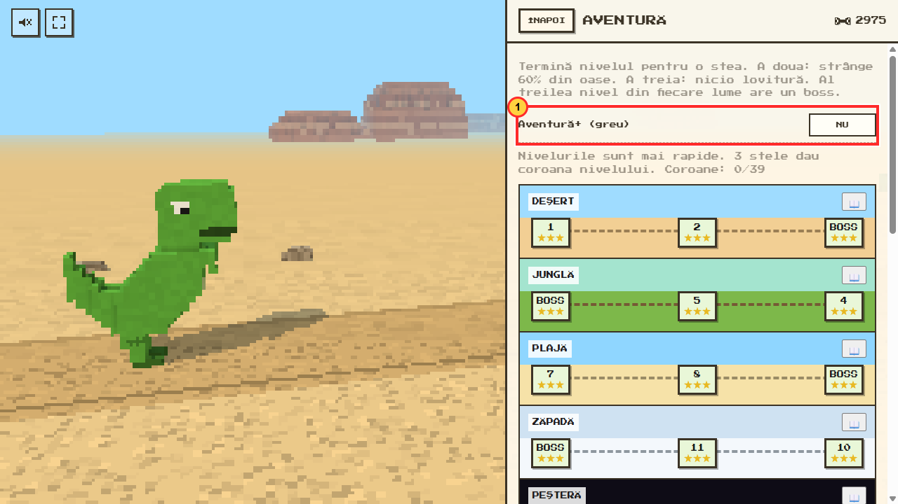

1. După finalul poveștii apare comutatorul **Aventură+ (greu)**. Când e pornit, nivelurile sunt mai rapide, iar cu 3 stele câștigi coroana nivelului.

### Colecția și Magazinul

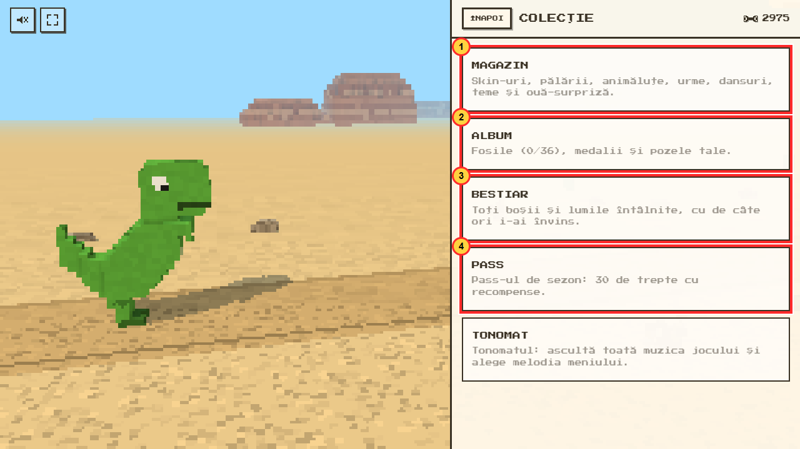

1. **Magazin.** Pe lângă skin-uri și accesorii: **Titluri** (lângă numele tău în LAN), **Abțibilduri** (pachete de 3; dublurile devin sclipici cu care cumperi ce lipsește) și **Măiestrie** (3 stele pentru fiecare skin, +5% oase fiecare).
2. **Album:** fosile, medalii și poze.
3. **Bestiar:** boșii și lumile întâlnite.
4. **Pass:** treptele pass-ului de sezon.

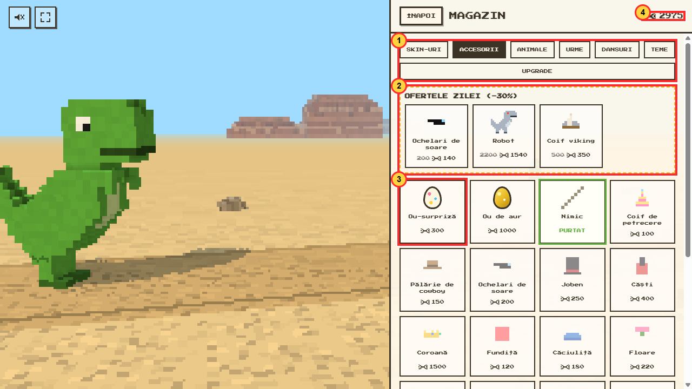

1. **Categoriile:** skin-uri, accesorii, animăluțe, urme, dansuri, teme și upgrade-uri.
2. **Ofertele zilei:** 3 lucruri cu -30%, aceleași toată ziua.
3. **Ouăle-surpriză:** un lucru la întâmplare. Oul de aur conține doar lucruri scumpe.
4. **Oasele** pe care le ai.

Prima atingere pe un lucru îl arată pe dino. A doua îl cumpără sau îl îmbracă.

### Multiplayer în rețea (LAN)

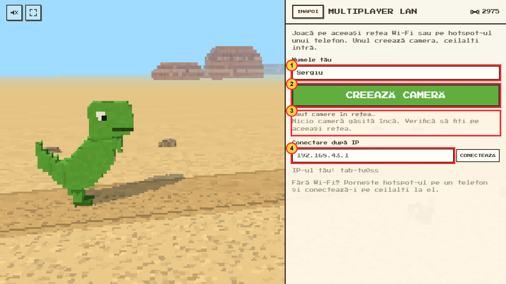

1. **Numele tău**, cum îl văd ceilalți.
2. **CREEAZĂ CAMERĂ:** tu ești gazda.
3. **Camerele găsite** în rețea. Apasă INTRĂ la camera prietenului.
4. Dacă nu apare nicio cameră, apasă **Scanează QR-ul gazdei** (gazda are codul în cameră) sau scrie **IP-ul gazdei** și apasă CONECTEAZĂ.
5. **Înapoi în camera lui …** apare dacă ai ieșit sau ți-a căzut Wi-Fi-ul: te întorci în aceeași cameră.
6. **Handicap**: fiecare își alege singur cât de ușor să-i fie (lume mai lentă și inimi în plus).
7. **Ultimele 10 curse** și **cine câștigă cel mai des** pe acest dispozitiv.

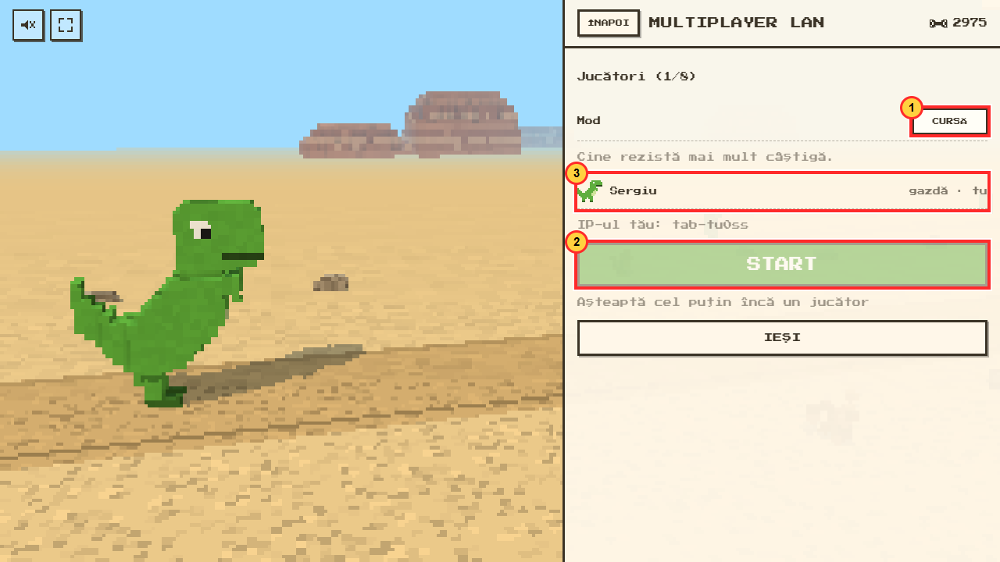

1. **Modul de joc**: toate cele 8 moduri se văd ca butoane cu imagine, iar sub ele e explicația celui ales. Doar gazda îl schimbă.
2. **START** pornește cursa pentru toți (e nevoie de cel puțin 2 jucători).
3. **Jucătorii** din cameră, cu echipa și handicapul lor. Butonul 🎁 trimite un cadou.
4. **Codul QR** al gazdei: prietenii îl scanează ca să intre direct.
5. **Traseul**: la întâmplare sau unul din editorul tău (la Cursă, Sabotaj, Turneu, Echipă și Echipe).

### Setări și transferul de progres

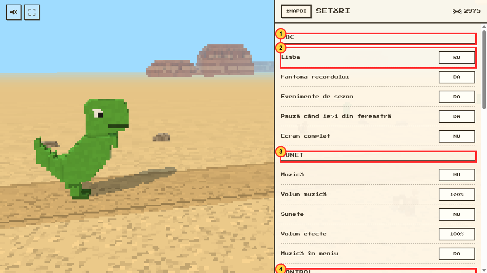

1. Setările sunt pe secțiuni: **Joc**, Sunet, Control, Grafică, Accesibilitate și Date.
2. Apasă butonul din dreapta unui rând ca să schimbi valoarea (de exemplu limba).
3. **Sunet:** muzica, efectele și volumul lor.
4. **Control:** tastele și comenzile pe ecran.

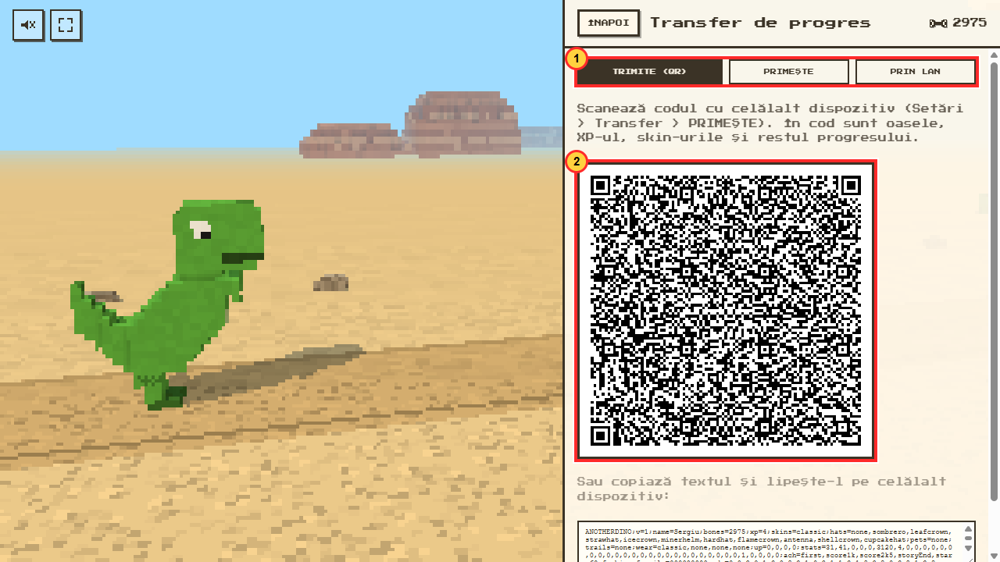

1. Alegi cum muți progresul: **TRIMITE (QR)**, **PRIMEȘTE** (scanezi cu camera sau lipești textul) sau **PRIN LAN** (Wi-Fi, cu PIN).
2. **Codul QR** cu tot progresul tău. Îl scanezi cu celălalt dispozitiv.

## Controale

| Acțiune | Tastatură | Telefon (zone) | Gamepad |
| --- | --- | --- | --- |
| Săritură | Space / ↑ | atingi jumătatea dreaptă | A / ↑ |
| Săritură mai înaltă | ții apăsat | ții degetul | ții apăsat |
| Ghemuire | ↓ | ții jumătatea stângă | B / ↓ |
| Lovitură în pământ | ↓ în aer | stânga în aer | B în aer |
| Pauză | Esc / P | butonul ⏸ | Start |

- Tastele se schimbă din **Setări > Control**.
- Pe telefon poți folosi zonele de ecran sau două butoane pe care le muți și le măresti cum vrei (**Setări > Control > Comenzi pe ecran**).
- **Comenzi inversate** schimbă stânga cu dreapta, pentru stângaci.
- În modul **Un singur buton** (Setări > Accesibilitate) folosești doar săritura, iar dino se ghemuiește singur sub pterodactili.

## Ce întâlnești pe drum

- **Cactuși și obstacolele fiecărei lumi:** treci peste ele cu o săritură.
- **Pterodactili** la 3 înălțimi: sus treci pe dedesubt, la mijloc te ghemuiești, jos sari.
- **Gropi:** sari peste ele. Dacă aterizezi în ele, pierzi.
- **Bolovani** care se rostogolesc și **meteoriți** care cad. Locul unde cade meteoritul e marcat cu un cerc roșu (albastru în modul pentru daltoniști).
- **Oase:** banii jocului. **Osul de aur** valorează 10.
- **Fosile:** se colecționează în Album, câte 3 în fiecare lume.

O săritură chiar înainte de obstacol dă **PERFECT** și crește combo-ul (x2, x3…). Combo-ul înmulțește punctele.

## Puteri speciale

| Putere | Ce face |
| --- | --- |
| Scut | Te salvează o dată de o lovitură. |
| Magnet | Atrage oasele din jur. |
| Încetinire | Jocul merge mai încet o vreme. |
| Săritură dublă | Poți sări încă o dată în aer. |
| Rachetă | Zbori peste tot, fără obstacole. |
| Uriaș | Dino crește și sparge obstacolele. |
| Ploaie de oase | Cad oase din cer. |

Cât țin puterile vezi în iconițele cu cronometru de sus.

## Lumile

În tura normală, lumea se schimbă la fiecare 1000 de puncte: deșert, junglă, plajă, zăpadă, peșteră, oraș în ruine, vulcan și spațiu (cu gravitație mică). După **8000 de puncte** urmează lumile din Aventură: sub apă (dino înoată, fiecare atingere e un impuls în sus), lumea dulce, mlaștina și insulele din nori. Apoi lumile se reiau în cerc.

Ziua se schimbă cu noaptea. Uneori vin evenimente: T-rex-ul uriaș care te fugărește, ploaia de meteoriți, bonusul de oase. La fiecare 2000 de puncte vine un **boss mic**: rezistă 14 secunde și primești oase, tot mai multe la fiecare boss din aceeași tură.

## Moduri de joc

Le găsești în meniul **Moduri**. Unele se deschid treptat, pe măsură ce joci.

| Mod | Ce e |
| --- | --- |
| **Joacă** | Tura obișnuită, fără sfârșit. Aici se face recordul. |
| **Aventură** | 13 lumi a câte 3 niveluri, cu linie de sosire. Al treilea nivel din fiecare lume are un boss. Primești 1 stea pentru terminare, încă una dacă strângi 60% din oase și a treia dacă nu te lovește nimic. Înaintea fiecărei lumi e un capitol de poveste. |
| **Aventură+** | Se deschide după finalul poveștii, din comutatorul de pe hartă. Nivelurile sunt mai rapide, iar cu 3 stele câștigi coroana nivelului. Fiecare nivel ține și cel mai bun timp. |
| **Provocarea zilei** | Același traseu pentru toți, cu o țintă de puncte. Seria de zile la rând dă recompense mai mari. |
| **Regula zilei** | O regulă specială pentru toată ziua: gravitație de Lună, noapte fără sfârșit, turbo, pterodactili peste tot sau ziua giganților. Oasele valorează mai mult. |
| **Boss Rush** | Toți cei 13 boși la rând, fără reînviere. Contează câți învingi și în cât timp. |
| **Tura sezonului** | O tură fără sfârșit în lumea sezonului (se schimbă în fiecare trimestru), cu oase x1,5 și record propriu. |
| **Zen** | Nu poți pierde, dar primești doar un sfert din oase. |
| **Hardcore** | Fără puteri și fără reînviere, dar cu oase duble. |
| **Contra robotului** | Alergi lângă un dino robot, pe 3 niveluri de dificultate. |
| **Editor de trasee** | Îți construiești traseul căsuță cu căsuță și îl trimiți prin QR. Tot aici e și traseul săptămânii. |
| **Provocare QR** | Trimiți un cod QR al turei tale, iar prietenul joacă același traseu și încearcă să te bată. |
| **Pe același ecran** | 2–4 jucători pe un dispozitiv, cu ecranul împărțit. Joacă fie **unul contra altul**, fie **în echipă**, cu 3 inimi comune și boss de echipă. |

## Multiplayer în rețea (LAN)

1. Toți jucătorii sunt pe același Wi-Fi sau pe hotspot-ul unui telefon.
2. **Moduri > Multiplayer**. Un jucător creează camera, ceilalți o aleg din listă (sau intră cu IP-ul gazdei).
3. Gazda alege modul și apasă START.

| Mod LAN | Ce e |
| --- | --- |
| Cursă | Câștigă cine ajunge cel mai departe. |
| Sabotaj | Arunci bolovani pe traseele celorlalți. |
| Eliminare | Viteza crește mult mai repede. Rămâne ultimul în viață. |
| Turneu | 5 curse la rând, cu puncte după loc. |
| Echipă | Toți împotriva traseului, cu 3 inimi comune. La fiecare 2000 de puncte vine un boss de echipă. |
| Echipe | Echipa A contra echipei B (pe rând, după lista din lobby). Câștigă suma punctelor. |
| Boși în echipă | Ca Echipa, dar boșii vin unul după altul, la fiecare 700 de puncte. |
| Ștafetă | Echipa A contra echipei B, dar aleargă câte unul din fiecare echipă. Când cade, următorul din echipă pleacă de unde a rămas, cu aceeași viteză. |
| Cupa 1 la 1 | Tablou cu eliminare: perechi, toți aleargă deodată, dar contează doar duelul tău. Câștigătorul trece în runda următoare, până la campion (+150 oase). |

- **Traseu din editor:** gazda poate alege un traseu făcut în editor. Câștigă cine trece primul linia de sosire (+250 de puncte), ceilalți după puncte.
- **Intrare târzie și reconectare:** poți intra într-o cameră în timpul cursei (aștepți următoarea). Dacă îți cade Wi-Fi-ul, jocul încearcă singur să se reconecteze 15 secunde.
- **Cadouri:** în lobby, 🎁 lângă un prieten: 25 sau 100 de oase, sau o gustare pentru animăluțul lui. Cel mult 5 pe zi; dacă nu ajunge, oasele se întorc.
- **Handicap:** Normal, Mai ușor (lumea cu 15% mai încet, +1 inimă) sau Mult mai ușor (30% mai încet, +2 inimi). Punctele se numără ca la ceilalți.
- **Doar mă uit:** stai în cameră ca spectator; camera îl urmărește pe cel din frunte.
- **Pachet de trasee:** gazda trimite toate traseele din editor tuturor din cameră (le găsesc în Editorul de trasee).
- **Mesaje rapide:** 8 fraze („Încă una!”, „Bravo!”, „GG”…) pe care le văd toți din cameră.

Pe PC, Windows întreabă de firewall la primul multiplayer: permite accesul în rețeaua privată.

## Colecție și progres

- **Magazin:** skin-uri, pălării, animăluțe, urme, dansuri de victorie, teme de meniu și upgrade-uri permanente. Ai și **ouăle-surpriză** și **ofertele zilei** (3 lucruri cu -30%).
- **Pălăriile boșilor:** fiecare boss din Aventură, învins prima dată, îți dă pălăria lumii lui.
- **Animăluțele** cresc cu distanța alergată împreună (5 niveluri) și primesc puteri tot mai mari. La nivelul 5 evoluează.
- **Editorul de skin:** îți pictezi dino-ul pixel cu pixel.
- **Album:** fosilele, medaliile (bronz, argint, aur pentru fiecare statistică) și pozele făcute în modul foto.
- **Bestiar:** fiecare boss și lume întâlnită, cu de câte ori i-ai învins.
- **Pass de sezon:** 30 de trepte gratuite, care se umplu cu XP.
- **Cufărul zilei:** un cadou în fiecare zi în care joci, mai mare dacă joci zile la rând.
- **Misiuni:** 3 misiuni active, 3 misiuni săptămânale mai mari și realizări permanente.
- **Cartea de jucător** (Progres): o imagine cu dino-ul tău, recordul, stelele și medaliile, de salvat sau trimis.
- **Tonomatul:** asculți toată muzica jocului și alegi melodia din meniu.

## Mutarea progresului pe alt dispozitiv

Jocul nu are server, așa că progresul se mută direct între dispozitive, din **Setări > Date > Transfer**:

- **Cod QR:** pe dispozitivul vechi arăți codul, pe cel nou îl scanezi cu camera.
- **Text:** copiezi codul și îl lipești pe celălalt dispozitiv.
- **Wi-Fi:** dispozitivul nou arată un PIN, iar cel vechi trimite progresul în rețeaua locală.

Progresul se **unește**: păstrezi ce ai pe ambele dispozitive și cel mai bun rezultat din fiecare.

## Setări

| Secțiune | Ce găsești |
| --- | --- |
| Joc | limba, fantoma recordului, evenimentele de sezon, pauza când ieși din fereastră, ecranul complet |
| Sunet | muzica, efectele, volumul fiecăreia, muzica din meniu |
| Control | tastele, comenzile pe ecran, comenzile inversate, vibrațiile |
| Grafică | calitatea (automată, înaltă, medie, joasă), stilul (contur, Game Boy, CRT), mărimea pixelilor, tremurarea ecranului, contorul de FPS |
| Accesibilitate | text mare, obstacole evidențiate, mod pentru daltoniști, mai puține efecte, un singur buton |
| Date | transferul de progres, ce e nou, actualizările (în aplicații), despre joc, setările implicite |

Setările implicite nu ating progresul. Butonul care șterge tot progresul are nevoie de două apăsări.

## Sfaturi

- Pe telefoanele slabe, alege **Grafică > Calitate > Joasă**.
- Upgrade-ul „Scut la start” și animăluțele ajută mult la primele recorduri.
- Fiecare boss are atacul lui: unii aruncă bolovani din cer (urmărește cercul roșu), alții rostogolesc bolovani pe traseu, iar caracatița trimite pești la înălțimi diferite.
